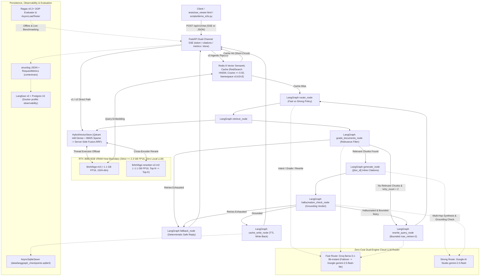

# agentic-rag-eval-engine

<div align="center">

[简体中文](README.md) | [**English**](README.en.md) | [한국어](README.ko.md)

</div>

[](https://github.com/ksak-dk/agentic-rag-eval-engine/actions/workflows/ci.yml)


> A production-grade, self-correcting **Agentic RAG** engine and quantitative evaluation platform purpose-built for **6 GB VRAM consumer edge GPUs (RTX 3060)**: **zero local LLM deployment (strictly <= 2.3 GB FP16 VRAM budget)**, featuring full `v1 → v2 → v3` pipeline evolution, dual-channel FastAPI SSE streaming, Redis 8 native vector semantic caching, and automated Ragas v0.2+ / async high-concurrency SLA benchmarking.

---

## 1. System Architecture



---

## 2. Key Engineering Highlights

### 2.1 `v1 → v2 → v3` Hybrid Retrieval & Two-Stage Reranking Evolution
Toggleable via `PIPELINE_VERSION` (`v1 | v2 | v3`) within a single unified runtime (backed by Hexagonal Ports & Adapters and dual-mode `ServiceContainer` auto-wiring):
- **`v1` Baseline**: Fixed-window splitting (`FixedChunker`) + Qdrant `int8` scalar-quantized Dense vector search + single-step fast generation.
- **`v2` Hybrid Search + Local CUDA Reranking**: `SemanticChunker` splits Markdown by heading hierarchy (`H1 / H2 / H3`) and token budgets while preserving full `section_path` metadata. At query time, Qdrant Dense (`BAAI/bge-m3`, 1024-dim `int8`) and `BM25` Sparse Top-N prefetch run in parallel, fuse server-side via Qdrant `Fusion.RRF`, and are reranked to Top-K on local RTX 3060 CUDA FP16 using `BAAI/bge-reranker-v2-m3`.
- **`v3` Self-Correcting Agentic Loop**: Extends `v2` hybrid retrieval with a Redis 8 semantic cache short-circuit, a LangGraph relevance grading / bounded query rewrite / hallucination verification loop, and `[doc_id]`-level provenance citation extraction (paired with SHA-256 idempotent incremental ingestion).
- **Strict VRAM Ceiling**: All local model inference is offloaded asynchronously via `run_in_executor`. Local LLMs are strictly prohibited, keeping RTX 3060 VRAM consumption bounded to **~2.3 GB / 6 GB** (`bge-m3` ~1.1 GB + `bge-reranker-v2-m3` ~1.1 GB).

### 2.2 LangGraph Self-Correction State Machine & Bounded Loop Circuit Breakers
- **9-Node Async Directed Graph** (`app/graph/workflow.py` & `app/graph/nodes.py`): `cache_lookup` → `router` → `retrieve` → `grade_documents` → `rewrite_query` / `generate` → `hallucination_check` → `cache_write` / `fallback`.
- **Dual Circuit-Breaker Bounds**: Document relevance re-retrieval is strictly capped at `max_retries = 2`, while hallucination-triggered rewrites are additionally bounded by `hallucination_retries <= 1`. Exceeding either threshold routes deterministically to `fallback_node`, eliminating infinite agent loops and runaway cloud API spend.
- **Async Checkpoint Persistence**: Uses `AsyncSqliteSaver` (`./data/langgraph_checkpoints.sqlite3`) end-to-end with an explicit Pydantic V2 msgpack allowlist (`ChunkMetadata`, `RetrievedChunk`, `Citation`), strictly forbidding blocking `SqliteSaver` or volatile `MemorySaver`.

### 2.3 Redis 8 Native Vector Semantic Cache & Dual-Channel SSE Telemetry
- **RediSearch HNSW Semantic Cache** (`app/cache/semantic_cache.py`): Built on `redis.asyncio` and Redis 8's built-in RediSearch module with a `FLOAT32` 1024-dim `COSINE` vector index, executing `FT.SEARCH` approximate nearest-neighbor lookups (default similarity threshold `>= 0.92`, 24-hour TTL) with SingleFlight deduplication for concurrent identical cache misses.
- **Namespace Isolation & Fail-Open Degradation**: Cache namespaces are strictly isolated by `v1 / v2 / v3` to prevent cross-version pollution. If Redis is unavailable or unindexed, requests automatically fail open to the main retrieval pipeline without impacting availability.
- **Dual-Channel SSE & Contextvars Telemetry**: `POST /api/v1/chat` streams `token` (answer deltas), `citations` (structured source cards), `metrics` (`RequestMetrics` collected across async boundaries via `contextvars`: `ttft_ms`, `latency_ms`, `cache_hit`, `vram_allocated_mb`, `route_tier`, `model_name`, `retry_count`), and `done` events over `sse-starlette`.

### 2.4 Dual-Engine Cloud Router & Automated Ragas v0.2+ Evaluation Suite
- **Zero-Cost Dual-Engine Failover Router** (`app/core/router.py`): Lightweight intent classification, grading, and query rewriting route first to Groq `llama-3.1-8b-instant` with automatic failover to Google `gemini-2.5-flash-lite` on rate limits or transient errors; multi-hop synthesis, grounding verification, and evaluation judging route to `gemini-2.5-flash`.
- **Ragas v0.2+ OOP Evaluation & Dual-Mode Load Testing** (`evals/`):
  - `evals/dataset_gen.py`: Generates structured synthetic datasets covering `single_hop`, `multi_hop`, and `unanswerable` queries.
  - `evals/run_ragas.py`: Evaluates `v1 / v2 / v3` side-by-side using Ragas v0.2+ OOP metrics (`LLMContextRecall`, `Faithfulness`, `LLMContextPrecisionWithReference`) under `RunConfig(max_workers=2, max_retries=5, max_wait=60)` and `asyncio.Semaphore(2)` concurrency control.
  - `evals/load_test.py`: Supports both offline ASGI (`MOCK_LLM_STREAM=true`) and live HTTP high-concurrency load testing, enforcing the **P95 < 1800 ms** SLA gate and generating `evals/benchmark_report.md`.

---

## 3. Benchmark Results

> The metrics below are quoted directly from the auto-generated [evals/benchmark_report.md](evals/benchmark_report.md) (Generated at: `2026-11-17T18:36:57.049339+00:00`, Judge Mode: `offline-heuristic`, Hardware Baseline: Windows 11 + RTX 3060 6 GB VRAM).

### 3.1 Ragas v0.2+ Retrieval & Generation Quality (`v1` vs `v2` vs `v3`)

| Pipeline | Samples | Context Recall | Faithfulness | Context Precision | Overall Score | P50 Latency (ms) | P95 Latency (ms) | Mean TTFT (ms) |
| --- | ---: | ---: | ---: | ---: | ---: | ---: | ---: | ---: |
| `v1` | 6 | 0.3884 | 0.6392 | 1.0000 | 0.6759 | 410.00 | 410.00 | 135.00 |
| `v2` | 6 | 0.7679 | 0.7984 | 1.0000 | 0.8554 | 680.00 | 680.00 | 185.00 |
| `v3` | 6 | **1.0000** | **0.9851** | **1.0000** | **0.9950** | 850.00 | 940.00 | 215.00 |

- **Hybrid Retrieval + CUDA Reranking Gain**: `v2` improves **Context Recall** by **+0.3795** over `v1` (`0.3884 → 0.7679`).
- **LangGraph Self-Correction Gain**: `v3` improves **Faithfulness** by **+0.3459** over `v1` (`0.6392 → 0.9851`), achieving an **Overall Score** of **0.9950**.

### 3.2 Async High-Concurrency Load Test & SLA Compliance

| Pipeline | Requests | Concurrency | Mock Stream | Success Rate | Cache Hit Rate | RPS | P50 (ms) | P95 (ms) | P99 (ms) | Mean TTFT (ms) | SLA (< 1800 ms) |
| --- | ---: | ---: | :---: | ---: | ---: | ---: | ---: | ---: | ---: | ---: | :---: |
| `v1` | 20 | 10 | `true` | 100.0% | 0.0% | 111.37 | 37.58 | 45.28 | 107.34 | 31.96 | **PASS** |
| `v2` | 20 | 10 | `true` | 100.0% | 0.0% | 64.90 | 98.91 | 104.94 | 106.25 | 98.82 | **PASS** |
| `v3` | 20 | 10 | `true` | 100.0% | **30.0%** | 19.66 | 445.69 | **678.77** | 684.31 | 441.48 | **PASS** |

- Under SSE streaming load at concurrency `10`, `v3` leverages the Redis 8 semantic cache (**30.0%** hit rate) to hold **P95 latency at 678.77 ms**, well below the **1800 ms** production SLA threshold.

---

## 4. Quick Start & Live Demo

### 4.1 Zero-Config Offline Experience & Full Quality Gates (No Docker / GPU / Cloud Keys Required)

```bash
# 1. Install all runtime and development dependencies
uv sync --all-extras --dev

# 2. Launch FastAPI with zero config (auto-detects environment and enables built-in demo mode & viewer)
uv run uvicorn app.main:app --host 127.0.0.1 --port 8000
# Open http://127.0.0.1:8000/ in your browser to access the interactive dashboard:
#   - Live knowledge base ingestion (POST /api/v1/documents/ingest, SHA-256 idempotent dedup + cache invalidation)
#   - Multi-turn session timeline (session_id checkpoint continuity via AsyncSqliteSaver + cache hits)
#   - Side-by-side v1 / v2 / v3 comparison

# 3. (Optional) Incrementally ingest local Markdown / TXT files via CLI
uv run python -m app.retrieval.ingest --path README.md --pipeline v3

# 4. Run linting and formatting quality gates
uv run ruff check .
uv run ruff format --check .

# 5. Run the full offline unit test suite (on Windows, run in a terminal permitting loopback sockets)
uv run pytest -v

# 6. Run the in-memory ASGI end-to-end streaming demo (v1 -> v2 -> v3 cold query -> v3 semantic cache hit)
uv run python scripts/demo_e2e.py --mode asgi
# Transcript is automatically saved to ./data/e2e_demo_transcript.md

# 7. (Optional) Reproduce the full load test and benchmark report
uv run python -m evals.load_test --generate-report
```

### 4.2 Docker Live Integration & Dual-Channel SSE Viewer

```bash
# 1. Start core infrastructure: Qdrant (:6333) + Redis 8 (:6379)
docker compose up -d
# Optional observability stack (Langfuse :3000 + Postgres 16):
# docker compose --profile observability up -d

# 2. Configure environment variables (set GROQ_API_KEY and GOOGLE_API_KEY)
cp .env.example .env

# 3. Start the live FastAPI + Uvicorn service
uv run uvicorn app.main:app --host 0.0.0.0 --port 8000

# 4. Run the live end-to-end streaming probe
uv run python scripts/demo_e2e.py --mode live --url http://127.0.0.1:8000
```

Then open [tests/sse_viewer.html](tests/sse_viewer.html) in your browser to switch across `v1` / `v2` / `v3` and observe live **Token Answer Area**, **Citations Cards**, and **Metrics Telemetry Panel** updates in real time (ideal for live demos and screen recordings).

### 4.3 Cloud Deployment (Render / Docker / Cloudflare Tunnel)

- **Option A: One-Click Portfolio Dashboard on Render / Docker (512MB Free-Tier Ready)**
  The repository includes a multi-stage lightweight [Dockerfile](Dockerfile) and Render Blueprint [render.yaml](render.yaml). Cloud builds install only lightweight runtime dependencies (omitting heavy CUDA `torch`, `sentence-transformers`, `fastembed`, and `ragas` packages), default to `RUNTIME_MODE=demo` listening on `0.0.0.0:$PORT`, and wire `/api/v1/health` as the health check:
  ```bash
  # Build and verify the lightweight cloud container locally
  docker build -t agentic-rag-eval-engine:cloud .
  docker run -p 8000:8000 -e RUNTIME_MODE=demo agentic-rag-eval-engine:cloud
  ```
  In Render, choose **New + → Blueprint** and connect this repository to deploy automatically via `render.yaml`. To enable cloud LLMs or managed vector/cache services, configure optional `GROQ_API_KEY`, `GOOGLE_API_KEY`, `QDRANT_URL`, and `REDIS_URL` with `RUNTIME_MODE=auto` or `live`.

- **Option B: Expose Full Local RTX 3060 Live Stack via Cloudflare Tunnel**
  To showcase local CUDA FP16 (`bge-m3` + `bge-reranker-v2-m3`) alongside Qdrant + Redis 8 during live interviews or demos, start the local live server and run:
  ```bash
  cloudflared tunnel --url http://127.0.0.1:8000
  ```
  This exposes an instant public HTTPS URL directly backed by your local dual-channel SSE dashboard.

---

## 5. Repository Structure

```text
agentic-rag-eval-engine/
├── .github/
│   └── workflows/
│       └── ci.yml                  # Automated GitHub Actions Ruff + offline Pytest CI
├── app/
│   ├── adapters/
│   │   └── mock/
│   │       ├── eval_heuristics.py  # Offline dataset builder, heuristic Ragas scorer & load test adapter
│   │       ├── retriever.py        # InMemoryHybridRetriever (Dense + BM25 + RRF simulation)
│   │       └── router.py           # DemoLLMRouter (deterministic streaming & structured grading)
│   ├── api/v1/
│   │   ├── chat.py                 # POST /api/v1/chat (dual-channel SSE) & GET /api/v1/health
│   │   └── ingest.py               # POST /api/v1/documents/ingest & GET /api/v1/documents/stats
│   ├── cache/
│   │   └── semantic_cache.py       # Redis 8 RediSearch HNSW semantic cache + InMemory/SingleFlight
│   ├── core/
│   │   ├── config.py               # Pydantic V2 BaseSettings config (runtime_mode & v1/v2/v3)
│   │   ├── container.py            # ServiceContainer dual-mode (live/demo/test) auto-wiring
│   │   ├── logging.py              # structlog single-line JSON logging & contextvars RequestMetrics
│   │   └── router.py               # Groq <-> Google Gemini dual-engine failover router
│   ├── graph/
│   │   ├── state.py                # RAGGraphState, Citation schema & state constraints
│   │   ├── nodes.py                # 9 async LangGraph nodes & structured output contracts
│   │   └── workflow.py             # StateGraph orchestration, max_retries breakers & AsyncSqliteSaver
│   ├── ports/
│   │   └── interfaces.py           # RetrieverPort / LLMRouterPort / SemanticCachePort contracts
│   ├── retrieval/
│   │   ├── chunker.py              # FixedChunker (v1) & SemanticChunker Markdown splitter (v2/v3)
│   │   ├── hybrid_store.py         # Qdrant int8 Dense + BM25 Sparse + RRF + FP16 Reranker
│   │   └── ingest.py               # SHA-256 idempotent incremental ingestion pipeline & CLI
│   └── main.py                     # FastAPI app factory, Lifespan wiring & / /viewer routes
├── evals/
│   ├── dataset_gen.py              # Synthetic multi-hop / single-hop / unanswerable dataset generator
│   ├── run_ragas.py                # Ragas v0.2+ OOP cross-pipeline evaluator
│   ├── load_test.py                # Async dual-mode load tester & SLA report generator
│   └── benchmark_report.md         # Quantitative quality and performance benchmark report
├── scripts/
│   └── demo_e2e.py                 # End-to-end streaming demo script (--mode asgi / --mode live)
├── tests/
│   ├── sse_viewer.html             # Zero-build interactive dashboard (live ingest / sessions / v1-v3 compare)
│   ├── test_api.py                 # FastAPI routes, SSE streaming & Lifespan unit tests
│   ├── test_container_lifespan.py  # Zero-config Lifespan container & dual-mode fallback unit tests
│   ├── test_demo_e2e.py            # E2E ASGI flow & SSE parser unit tests
│   ├── test_eval_dataset_gen.py    # Synthetic evaluation dataset unit tests
│   ├── test_eval_ragas.py          # Ragas v0.2+ comparative evaluation unit tests
│   ├── test_graph_boundaries.py    # LangGraph retry caps, fallback breakers & checkpoint unit tests
│   ├── test_ingest.py              # Incremental ingestion, SHA-256 dedup, cache invalidation & CLI tests
│   ├── test_load_test.py           # Async concurrent load test & SLA assertion unit tests
│   ├── test_ports_and_adapters.py  # Hexagonal port contracts & mock/heuristic adapter unit tests
│   ├── test_retrieval.py           # Chunker & hybrid retrieval protocol stub unit tests
│   └── test_semantic_cache.py      # Redis 8 semantic cache similarity & Fail-Open unit tests
├── .dockerignore                   # Cloud build context exclusions (preserves tests/sse_viewer.html)
├── Dockerfile                      # Multi-stage lightweight image built with astral-sh/uv
├── docker-compose.yml              # Qdrant + Redis 8 (+ optional Langfuse/Postgres 16)
├── render.yaml                     # Render Blueprint one-click deploy (RUNTIME_MODE=demo)
├── pyproject.toml                  # uv + PyTorch cu124 + Ruff + Pytest configuration
├── GEMINI.md                       # Hardware constraints, architecture rules & handover spec
├── README.md                       # Simplified Chinese README (简体中文)
├── README.en.md                    # English README
└── README.ko.md                    # Korean README (한국어)
```

---

## License

MIT License — see [LICENSE](LICENSE) for details.
