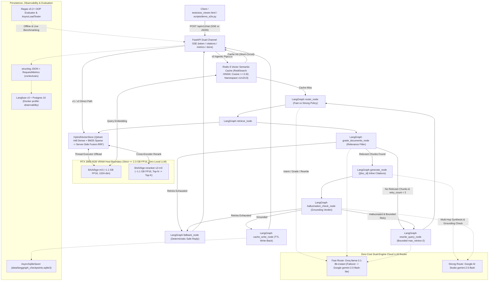

# agentic-rag-eval-engine

<div align="center">

[简体中文](README.md) | [English](README.en.md) | [**한국어**](README.ko.md)

</div>

[](https://github.com/ksak-dk/agentic-rag-eval-engine/actions/workflows/ci.yml)


> **6 GB VRAM 소비자용 엣지 GPU(RTX 3060)** 환경에 최적화된 프로덕션급 자가 교정 **Agentic RAG** 엔진 및 정량 평가 플랫폼입니다. **로컬 LLM 제로 배포(엄격한 `<= 2.3 GB` FP16 VRAM 예산)** 원칙하에 `v1 → v2 → v3` 아키텍처 진화, 이중 채널(Dual-Channel) FastAPI SSE 스트리밍, Redis 8 네이티브 벡터 시맨틱 캐시(Semantic Cache), 그리고 Ragas v0.2+ 및 비동기 고동시성 SLA 자동화 벤치마크를 완벽하게 지원합니다.

---

## 1. 시스템 아키텍처 개요 (System Architecture)



---

## 2. 핵심 엔지니어링 하이라이트 (Key Engineering Highlights)

### 2.1 `v1 → v2 → v3` 하이브리드 검색 및 2단계 재정렬 진화
헥사고날 아키텍처 (Hexagonal Architecture, Ports & Adapters)와 이중 모드 `ServiceContainer` 자동 조립을 기반으로, 단일 런타임 내 `PIPELINE_VERSION`(`v1 | v2 | v3`) 설정 스위치만으로 3세대 파이프라인을 정량 비교할 수 있습니다.
- **`v1` 베이스라인**: 고정 윈도우 분할(`FixedChunker`) + Qdrant `int8` 스칼라 양자화(Scalar Quantization) Dense 벡터 검색 + 단일 스텝 고속 생성.
- **`v2` 하이브리드 검색 (Hybrid Search) + 로컬 CUDA 재정렬**: `SemanticChunker`가 Markdown 헤더 계층(`H1 / H2 / H3`)과 토큰 예산을 기준으로 분할하며 전체 `section_path` 메타데이터를 보존합니다. 검색 시 Qdrant Dense(`BAAI/bge-m3` 1024차원 `int8`)와 `BM25` Sparse Top-N 프리페치를 병렬 실행한 뒤 Qdrant 서버 측 `Fusion.RRF`로 융합하고, 로컬 RTX 3060 CUDA FP16 `BAAI/bge-reranker-v2-m3` 교차 인코더 재정렬(Cross-Encoder Reranking)을 거쳐 Top-K로 정제합니다.
- **`v3` 자가 교정 에이전트 루프 (Self-Correcting Agentic Loop)**: `v2` 하이브리드 검색 위에 Redis 8 시맨틱 캐시(Semantic Cache) 쇼트서킷 경로, LangGraph 기반 문서 관련성 평가 / 바운디드 쿼리 재작성 / 환각(Hallucination) 검증 루프, `[doc_id]` 단위 출처 역추적 인용 추출, 그리고 SHA-256 멱등성 문서 수집(Idempotent Ingestion) 파이프라인을 통합했습니다.
- **엄격한 하드웨어 VRAM 제약**: 모든 로컬 모델 추론은 `run_in_executor`로 비동기 오프로드하며 로컬 LLM 로딩을 원천 차단해, RTX 3060 VRAM 점유율을 **~2.3 GB / 6 GB** 이내로 유지합니다(`bge-m3` ~1.1 GB + `bge-reranker-v2-m3` ~1.1 GB).

### 2.2 LangGraph 자가 교정 상태 머신 및 무한 루프 차단 서킷 브레이커
- **9노드 비동기 방향 그래프** (`app/graph/workflow.py` & `app/graph/nodes.py`): `cache_lookup` → `router` → `retrieve` → `grade_documents` → `rewrite_query` / `generate` → `hallucination_check` → `cache_write` / `fallback`.
- **이중 안전장치 서킷 브레이커**: 문서 관련성 재검색은 `max_retries = 2`로 엄격히 제한되며, 환각 검증 실패 시의 2차 재작성 역시 `hallucination_retries <= 1`로 제한됩니다. 상한 도달 시 즉시 결정론적 `fallback_node`로 라우팅하여 에이전트 무한 루프와 클라우드 API 비용 폭주를 원천 차단합니다.
- **비동기 체크포인트 영속화**: 전 구간에 `AsyncSqliteSaver`(`./data/langgraph_checkpoints.sqlite3`)를 적용하고 Pydantic V2 msgpack 허용 목록(`ChunkMetadata`, `RetrievedChunk`, `Citation`)을 명시적으로 등록했으며, 블로킹 방식의 `SqliteSaver`나 휘발성 `MemorySaver` 사용을 금지합니다.

### 2.3 Redis 8 네이티브 벡터 시맨틱 캐시 및 이중 채널 SSE 텔레메트리
- **RediSearch HNSW 시맨틱 캐시** (`app/cache/semantic_cache.py`): `redis.asyncio` 및 Redis 8 내장 RediSearch 모듈 기반으로 `FLOAT32` 1024차원 `COSINE` 벡터 인덱스를 구축해 `FT.SEARCH` 근사 최근접 이웃(ANN) 검색을 수행하며(기본 유사도 임계값 `>= 0.92`, 24시간 TTL), 동일 미스 동시 요청을 병합하는 SingleFlight 중복 제거를 지원합니다.
- **네임스페이스 격리 및 Fail-Open 폴백**: `v1 / v2 / v3`별로 캐시 네임스페이스를 엄격히 분리해 버전 간 오염을 방지하며, Redis 장애나 인덱스 미생성 시 자동으로 Fail-Open 처리하여 핵심 Q&A 가용성을 보장합니다.
- **이중 채널 SSE (Dual-Channel SSE) 및 `contextvars` 텔레메트리**: `POST /api/v1/chat`은 `sse-starlette`를 통해 `token`(본문 스트림), `citations`(구조화된 출처 카드), `metrics`(비동기 태스크 경계를 넘어 `contextvars`로 수집한 `RequestMetrics`: `ttft_ms`, `latency_ms`, `cache_hit`, `vram_allocated_mb`, `route_tier`, `model_name`, `retry_count`), 그리고 `done` 이벤트를 순차 스트리밍합니다.

### 2.4 이중 엔진 클라우드 라우터 및 Ragas v0.2+ 자동화 평가 체계
- **무과금 이중 엔진 장애 조치 라우터 (Dual-Engine Failover Router)** (`app/core/router.py`): 경량 의도 분류, 문서 평가 및 쿼리 재작성은 Groq `llama-3.1-8b-instant`로 우선 라우팅하고 레이트 리밋이나 장애 발생 시 Google `gemini-2.5-flash-lite`로 자동 페일오버합니다. 멀티홉 종합 생성, 그라운딩 검증 및 평가 심판(Judge)은 `gemini-2.5-flash`로 라우팅합니다.
- **Ragas v0.2+ OOP 평가 및 이중 모드 부하 테스트** (`evals/`):
  - `evals/dataset_gen.py`: `single_hop`, `multi_hop`, `unanswerable` 유형을 포괄하는 구조화된 합성 평가 데이터셋을 생성합니다.
  - `evals/run_ragas.py`: Ragas v0.2+ OOP 메트릭(`LLMContextRecall`, `Faithfulness`, `LLMContextPrecisionWithReference`)과 `RunConfig(max_workers=2, max_retries=5, max_wait=60)`, `asyncio.Semaphore(2)` 동시성 제어를 결합해 `v1 / v2 / v3` 횡단 비교를 수행합니다.
  - `evals/load_test.py`: 오프라인 ASGI(`MOCK_LLM_STREAM=true`) 및 라이브 HTTP 이중 모드 고동시성 부하 테스트를 지원하며, **P95 < 1800 ms** SLA 기준선을 자동 검증하고 `evals/benchmark_report.md`를 생성합니다.

---

## 3. 정량 평가 및 성능 부하 테스트 베이스라인 (Benchmark Results)

> 아래 지표는 자동 생성된 [evals/benchmark_report.md](evals/benchmark_report.md)에서 직접 발췌했습니다 (생성 시각: `2026-11-17T18:36:57.049339+00:00`, Judge Mode: `offline-heuristic`, 하드웨어 베이스라인: Windows 11 + RTX 3060 6 GB VRAM).

### 3.1 Ragas v0.2+ 검색 및 생성 품질 비교 (`v1` vs `v2` vs `v3`)

| Pipeline | Samples | Context Recall | Faithfulness | Context Precision | Overall Score | P50 Latency (ms) | P95 Latency (ms) | Mean TTFT (ms) |
| --- | ---: | ---: | ---: | ---: | ---: | ---: | ---: | ---: |
| `v1` | 6 | 0.3884 | 0.6392 | 1.0000 | 0.6759 | 410.00 | 410.00 | 135.00 |
| `v2` | 6 | 0.7679 | 0.7984 | 1.0000 | 0.8554 | 680.00 | 680.00 | 185.00 |
| `v3` | 6 | **1.0000** | **0.9851** | **1.0000** | **0.9950** | 850.00 | 940.00 | 215.00 |

- **하이브리드 검색 + CUDA 재정렬 효과**: `v2`는 `v1` 대비 **Context Recall**이 **+0.3795** 향상되었습니다 (`0.3884 → 0.7679`).
- **LangGraph 자가 교정 루프 효과**: `v3`는 `v1` 대비 **Faithfulness**가 **+0.3459** 향상되었으며 (`0.6392 → 0.9851`), 종합 **Overall Score** **0.9950**을 달성했습니다.

### 3.2 비동기 고동시성 부하 테스트 및 SLA 달성 현황

| Pipeline | Requests | Concurrency | Mock Stream | Success Rate | Cache Hit Rate | RPS | P50 (ms) | P95 (ms) | P99 (ms) | Mean TTFT (ms) | SLA (< 1800 ms) |
| --- | ---: | ---: | :---: | ---: | ---: | ---: | ---: | ---: | ---: | ---: | :---: |
| `v1` | 20 | 10 | `true` | 100.0% | 0.0% | 111.37 | 37.58 | 45.28 | 107.34 | 31.96 | **PASS** |
| `v2` | 20 | 10 | `true` | 100.0% | 0.0% | 64.90 | 98.91 | 104.94 | 106.25 | 98.82 | **PASS** |
| `v3` | 20 | 10 | `true` | 100.0% | **30.0%** | 19.66 | 445.69 | **678.77** | 684.31 | 441.48 | **PASS** |

- 동시성 `10`의 SSE 스트리밍 부하 테스트에서 `v3`는 Redis 8 시맨틱 캐시(**30.0%** 히트율)를 통해 **P95 지연을 678.77 ms**로 억제하여, 프로덕션 SLA 기준선(**1800 ms**)을 여유 있게 통과했습니다.

---

## 4. 빠른 시작 및 라이브 데모 가이드 (Quick Start & Live Demo)

### 4.1 제로 설정 오프라인 체험 및 전체 품질 게이트 (Docker / GPU / 클라우드 키 불필요)

```bash
# 1. 전체 런타임 및 개발 도구 의존성 설치
uv sync --all-extras --dev

# 2. 제로 설정으로 FastAPI 즉시 실행 (환경 자동 감지 후 내장 demo 모드 및 대시보드 활성화)
uv run uvicorn app.main:app --host 127.0.0.1 --port 8000
# 실행 후 브라우저에서 http://127.0.0.1:8000/ 접속 시 인터랙티브 대시보드 사용 가능:
#   - 실시간 지식 베이스 수집 (POST /api/v1/documents/ingest, SHA-256 멱등성 중복 제거 + 시맨틱 캐시 무효화)
#   - 멀티턴 세션 타임라인 (session_id 기반 AsyncSqliteSaver 체크포인트 이어받기 및 캐시 히트 검증)
#   - v1 / v2 / v3 동일 화면 동시 비교

# 3. (선택) CLI를 통한 로컬 Markdown / TXT 문서 증분 수집
uv run python -m app.retrieval.ingest --path README.md --pipeline v3

# 4. 코드 스타일 및 포맷팅 품질 게이트 검증
uv run ruff check .
uv run ruff format --check .

# 5. 전체 오프라인 단위 테스트 실행 (Windows에서는 로컬 루프백 소켓이 허용된 터미널에서 실행)
uv run pytest -v

# 6. 인메모리 ASGI 엔드투엔드 스트리밍 데모 실행 (v1 -> v2 -> v3 콜드 쿼리 -> v3 Redis 시맨틱 캐시 히트)
uv run python scripts/demo_e2e.py --mode asgi
# 데모 실행 로그는 ./data/e2e_demo_transcript.md 에 자동 저장됩니다.

# 7. (선택) 전체 부하 테스트 및 벤치마크 리포트 재현
uv run python -m evals.load_test --generate-report
```

### 4.2 Docker 실환경 연동 및 이중 채널 SSE 시각화 대시보드

```bash
# 1. 상시 인프라 기동: Qdrant (:6333) + Redis 8 (:6379)
docker compose up -d
# Langfuse (:3000) + Postgres 16 관측성(Observability) 스택을 함께 켜려면:
# docker compose --profile observability up -d

# 2. 환경 변수 설정 (GROQ_API_KEY 및 GOOGLE_API_KEY 입력)
cp .env.example .env

# 3. FastAPI + Uvicorn 라이브 서버 실행
uv run uvicorn app.main:app --host 0.0.0.0 --port 8000

# 4. 라이브 환경 엔드투엔드 스트리밍 프로브 실행
uv run python scripts/demo_e2e.py --mode live --url http://127.0.0.1:8000
```

이후 브라우저에서 [tests/sse_viewer.html](tests/sse_viewer.html)을 직접 열면 `v1` / `v2` / `v3`를 전환하며 **Token Answer Area**, **Citations Cards**, **Metrics Telemetry Panel** 3대 채널의 실시간 연동을 한눈에 확인할 수 있습니다 (라이브 데모 및 녹화에 최적화).

---

## 5. 저장소 디렉토리 구조 (Repository Structure)

```text
agentic-rag-eval-engine/
├── .github/
│   └── workflows/
│       └── ci.yml                  # GitHub Actions 자동화 Ruff + 오프라인 Pytest CI
├── app/
│   ├── adapters/
│   │   └── mock/
│   │       ├── eval_heuristics.py  # 오프라인 데이터셋 빌더, Ragas 휴리스틱 채점 및 부하 테스트 어댑터
│   │       ├── retriever.py        # InMemoryHybridRetriever (Dense + BM25 + RRF 시뮬레이션)
│   │       └── router.py           # DemoLLMRouter (결정론적 스트리밍 응답 및 구조화 검증)
│   ├── api/v1/
│   │   ├── chat.py                 # POST /api/v1/chat (이중 채널 SSE) & GET /api/v1/health
│   │   └── ingest.py               # POST /api/v1/documents/ingest & GET /api/v1/documents/stats
│   ├── cache/
│   │   └── semantic_cache.py       # Redis 8 RediSearch HNSW 시맨틱 캐시 + InMemory/SingleFlight
│   ├── core/
│   │   ├── config.py               # Pydantic V2 BaseSettings 설정 센터 (runtime_mode & v1/v2/v3)
│   │   ├── container.py            # ServiceContainer 이중 모드 (live/demo/test) 자동 조립 컨테이너
│   │   ├── logging.py              # structlog 단일 행 JSON 로깅 및 contextvars RequestMetrics
│   │   └── router.py               # Groq <-> Google Gemini 이중 엔진 자동 장애 조치 라우터
│   ├── graph/
│   │   ├── state.py                # RAGGraphState, Citation 스키마 및 상태 제약
│   │   ├── nodes.py                # 9개 비동기 LangGraph 노드 및 구조화 출력 계약
│   │   └── workflow.py             # StateGraph 오케스트레이션, max_retries 차단기 및 AsyncSqliteSaver
│   ├── ports/
│   │   └── interfaces.py           # RetrieverPort / LLMRouterPort / SemanticCachePort 포트 계약
│   ├── retrieval/
│   │   ├── chunker.py              # FixedChunker (v1) & SemanticChunker Markdown 분할기 (v2/v3)
│   │   ├── hybrid_store.py         # Qdrant int8 Dense + BM25 Sparse + RRF + FP16 Reranker
│   │   └── ingest.py               # SHA-256 멱등성 증분 문서 수집 파이프라인 및 CLI
│   └── main.py                     # FastAPI 앱 팩토리, Lifespan 컨테이너 조립 및 / /viewer 라우트
├── evals/
│   ├── dataset_gen.py              # 합성 multi-hop / single-hop / unanswerable 평가 데이터셋 생성기
│   ├── run_ragas.py                # Ragas v0.2+ OOP 멀티 파이프라인 비교 평가기
│   ├── load_test.py                # 비동기 고동시성 이중 모드 부하 테스터 및 SLA 리포트 생성기
│   └── benchmark_report.md         # 정량 품질 및 성능 베이스라인 평가 리포트
├── scripts/
│   └── demo_e2e.py                 # 원클릭 엔드투엔드 스트리밍 데모 스크립트 (--mode asgi / --mode live)
├── tests/
│   ├── sse_viewer.html             # 제로 빌드 인터랙티브 대시보드 (실시간 수집 / 멀티턴 / v1-v3 동시 비교)
│   ├── test_api.py                 # FastAPI 라우트, SSE 스트리밍 및 Lifespan 단위 테스트
│   ├── test_container_lifespan.py  # 제로 설정 Lifespan 컨테이너 및 이중 모드 폴백 단위 테스트
│   ├── test_demo_e2e.py            # E2E ASGI 전체 흐름 및 SSE 파서 단위 테스트
│   ├── test_eval_dataset_gen.py    # 합성 평가 데이터셋 생성 단위 테스트
│   ├── test_eval_ragas.py          # Ragas v0.2+ 비교 평가 단위 테스트
│   ├── test_graph_boundaries.py    # LangGraph 재시도 상한, 폴백 차단기 및 체크포인트 단위 테스트
│   ├── test_ingest.py              # 증분 수집, SHA-256 중복 제거, 캐시 무효화 및 CLI 단위 테스트
│   ├── test_load_test.py           # 비동기 동시 부하 테스트 및 SLA 판정 단위 테스트
│   ├── test_ports_and_adapters.py  # 헥사고날 포트 계약 및 오프라인/휴리스틱 어댑터 단위 테스트
│   ├── test_retrieval.py           # 청커 및 하이브리드 검색 프로토콜 스텁 단위 테스트
│   └── test_semantic_cache.py      # Redis 8 시맨틱 캐시 유사도 및 Fail-Open 단위 테스트
├── docker-compose.yml              # Qdrant + Redis 8 (+ 선택적 Langfuse/Postgres 16)
├── pyproject.toml                  # uv + PyTorch cu124 + Ruff + Pytest 프로젝트 설정
├── GEMINI.md                       # 하드웨어 제약, 아키텍처 기준선 및 자동 인수인계 규약
├── README.md                       # 중국어(간체) README (简体中文)
├── README.en.md                    # 영문 README (English)
└── README.ko.md                    # 한국어 README
```

---

## License

MIT License — see [LICENSE](LICENSE) for details.
