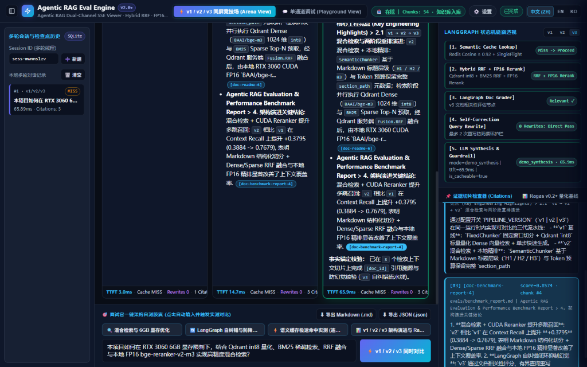
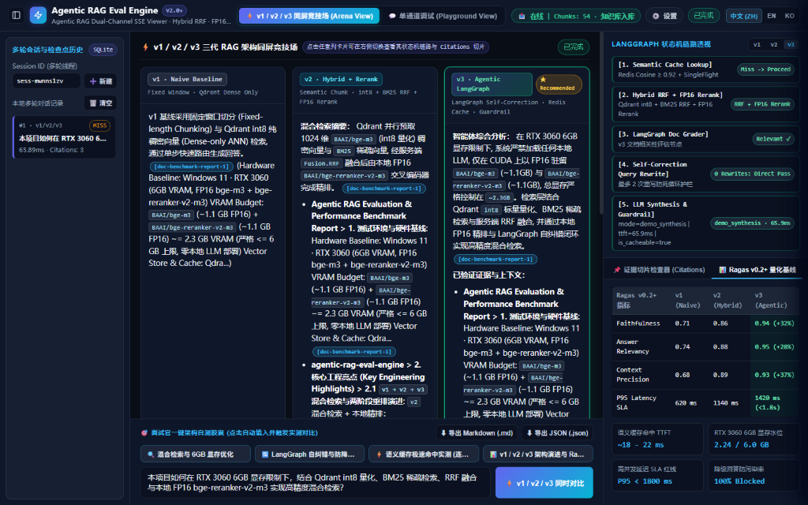
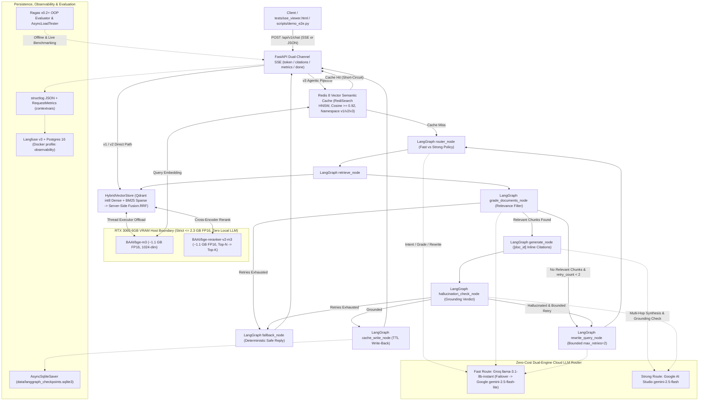

# agentic-rag-eval-engine

<div align="center">

[**简体中文**](README.md) | [English](README.en.md) | [한국어](README.ko.md)

</div>

[](https://github.com/ksak-dk/agentic-rag-eval-engine/actions/workflows/ci.yml)
[](https://agentic-rag-eval-engine.onrender.com)


> 面向 **6 GB VRAM 消费级边缘显卡（RTX 3060）** 设计的生产级自纠错 **Agentic RAG** 引擎与量化评测平台：**本地零 LLM 部署（严格 ≤ 2.3 GB FP16 显存预算）**，完整覆盖 `v1 → v2 → v3` 架构演进、双通道 FastAPI SSE 流式输出、Redis 8 原生向量语义缓存与 Ragas v0.2+ / 异步并发 SLA 自动化基线评测。

## 界面预览 (Preview)



*三代架构（v1 / v2 / v3）同屏流式对比，右侧 Inspector 联动展示 LangGraph 链路与 Citations 证据切片。*



*同一工作台的 Ragas v0.2+ 量化基线视图，工作台操作栏支持一键导出 Markdown / JSON 评测报告。*

### 三代架构演进一览

| 流水线 | 核心组件 | 解决的工程痛点 | Context Recall | Faithfulness | Overall | P95（压测，ms） |
| --- | --- | --- | ---: | ---: | ---: | ---: |
| `v1` Naive Baseline | 固定窗口切分 + Qdrant `int8` Dense 检索 + 单步生成 | 建立可对比的最小基线 | 0.3884 | 0.6392 | 0.6759 | 28.00 |
| `v2` Hybrid RRF + FP16 Rerank | Markdown 语义切分 + Dense/BM25 + 服务端 RRF + 本地 `bge-reranker-v2-m3` | 稀疏/稠密互补，提升多跳召回与排序精度 | 0.7679 | 0.7984 | 0.8554 | 110.06 |
| `v3` Agentic LangGraph + Redis Semantic Cache | `v2` + 相关性评分 / 有界重写 / 幻觉校验 + Redis 8 语义缓存 | 抑制幻觉、避免死循环，缓存命中削峰（30.0%） | 1.0000 | 0.9851 | 0.9950 | 680.97 |

> 数据来源：[evals/benchmark_report.md](evals/benchmark_report.md)（`offline-heuristic`，详见第 3 节）。

---

## 1. 系统架构全景图 (System Architecture)



---

## 2. 核心工程亮点 (Key Engineering Highlights)

### 2.1 `v1 → v2 → v3` 混合检索与两阶段重排演进
通过配置开关 `PIPELINE_VERSION`（`v1 | v2 | v3`）在同一运行时内实现可对比的三代流水线：
- **`v1` 基线**：`FixedChunker` 固定窗口切分 + Qdrant `int8` 标量量化 Dense 向量检索 + 单步快速生成。
- **`v2` 混合检索 + 本地精排**：`SemanticChunker` 基于 Markdown 标题层级（`H1 / H2 / H3`）与 Token 预算保留完整 `section_path` 元数据；检索阶段并行执行 Qdrant Dense（`BAAI/bge-m3` 1024 维 `int8`）与 `BM25` Sparse Top-N 预取，经 Qdrant 服务端 `Fusion.RRF` 融合后，由本地 RTX 3060 CUDA FP16 `BAAI/bge-reranker-v2-m3` 精排至 Top-K。
- **`v3` 自纠错智能体闭环**：在 `v2` 混合检索基础上引入 Redis 8 语义缓存短路径、LangGraph 相关性评分 / 有界重写 / 幻觉校验闭环，以及 `[doc_id]` 级溯源引用抽取。
- **硬件显存硬约束**：所有本地模型推理通过 `run_in_executor` 异步卸载，严禁加载任何本地 LLM，将 RTX 3060 显存占用严格控制在 **~2.3 GB / 6 GB**（`bge-m3` ~1.1 GB + `bge-reranker-v2-m3` ~1.1 GB）。

### 2.2 LangGraph 自纠错状态机与防死循环熔断边界
- **9 节点异步有向图**（`app/graph/workflow.py` & `app/graph/nodes.py`）：`cache_lookup` → `router` → `retrieve` → `grade_documents` → `rewrite_query` / `generate` → `hallucination_check` → `cache_write` / `fallback`。
- **双保险熔断机制**：文档相关性重检索严格受 `max_retries = 2` 约束，幻觉检查二次重写另受 `hallucination_retries <= 1` 约束；一旦触发上限即路由至确定性 `fallback_node`，彻底消除 Agent 无限循环与云端 API 预算失控风险。
- **异步检查点持久化**：全链路采用 `AsyncSqliteSaver`（`./data/langgraph_checkpoints.sqlite3`）并显式注册 Pydantic V2 msgpack 白名单（`ChunkMetadata`、`RetrievedChunk`、`Citation`），严禁使用阻塞式 `SqliteSaver` 或非持久化 `MemorySaver`。

### 2.3 Redis 8 原生向量语义缓存与双通道 SSE 遥测
- **RediSearch HNSW 语义缓存**（`app/cache/semantic_cache.py`）：基于 `redis.asyncio` 与 Redis 8 内置 RediSearch 模块构建 `FLOAT32` 1024 维 `COSINE` 向量索引，执行 `FT.SEARCH` 近似最近邻检索（默认相似度阈值 `>= 0.92`、24 小时 TTL）。
- **命名空间隔离与 Fail-Open 降级**：按 `v1 / v2 / v3` 严格隔离缓存命名空间防止版本串味；当 Redis 不可用或索引异常时自动 Fail-Open 放行主流程，不影响核心问答可用性。
- **双通道 SSE 与异步上下文遥测**：`POST /api/v1/chat` 基于 `sse-starlette` 依次推送 `token`（正文流）、`citations`（结构化来源卡片）、`metrics`（`contextvars` 跨异步任务收集的 `RequestMetrics`：`ttft_ms`、`latency_ms`、`cache_hit`、`vram_allocated_mb`、`route_tier`、`model_name`、`retry_count`）与 `done` 事件。

### 2.4 双引擎云端路由与 Ragas v0.2+ 自动化评测体系
- **零成本双引擎容灾路由**（`app/core/router.py`）：简单意图/评分/重写优先走 Groq `llama-3.1-8b-instant`，遭遇限流或异常时自动故障转移至 Google `gemini-2.5-flash-lite`；多跳综合生成、幻觉校验与评测裁判路由至 `gemini-2.5-flash`。
- **Ragas v0.2+ OOP 评测与双模式压测**（`evals/`）：
  - `evals/dataset_gen.py`：生成覆盖 `single_hop`、`multi_hop` 与 `unanswerable` 的结构化合成测试集。
  - `evals/run_ragas.py`：使用 Ragas v0.2+ OOP 指标（`LLMContextRecall`、`Faithfulness`、`LLMContextPrecisionWithReference`）配合 `RunConfig(max_workers=2, max_retries=5, max_wait=60)` 与 `asyncio.Semaphore(2)` 并发控制完成 `v1 / v2 / v3` 横向对比。
  - `evals/load_test.py`：支持离线 ASGI（`MOCK_LLM_STREAM=true`）与实机 HTTP 双模式高并发压测，自动校验 **P95 < 1800 ms** SLA 红线并生成 `evals/benchmark_report.md`。

### 2.5 端侧 6GB 显存优化、工程亮点与工程规范
- **6 GB VRAM 预算**：仅本地加载 `bge-m3`（~1.1 GB FP16）与 `bge-reranker-v2-m3`（~1.1 GB FP16），合计 ~2.3 GB，严禁本地 LLM，推理通过 `run_in_executor` 异步卸载。
- **SHA-256 幂等入库与防缓存污染**：重复文档按内容哈希跳过；入库后自动失效语义缓存；降级回答与含 HTML 污染的回答被 `is_cacheable_response` 拦截，不会写入缓存。
- **三语 SSE 工作台与一键导出**：`tests/sse_viewer.html` 支持 `ZH / EN / KO` 切换、三代同屏流式对比、可随时中止生成，并可在前端纯本地导出 `rag-eval-report-YYYYMMDD-HHMMSS.md / .json` 评测报告。
- **工程规范与自动化门禁**：仓库公开 [GEMINI.md](GEMINI.md)（架构红线与零成本离线约束）、`.agents/skills/`（6 阶段 Spec / TDD 工作流技能）与 `.agent/workflows/`（`/plan`、`/debug`、`/verify`）；GitHub Actions CI 执行 `ruff check`、`ruff format --check` 与离线 `pytest`。

---

## 3. 量化评测与性能压测基线 (Benchmark Results)

> 以下数据直接引自自动化生成的 [evals/benchmark_report.md](evals/benchmark_report.md)（生成时间：`2026-11-19T14:35:30.996430+00:00`，Judge Mode：`offline-heuristic`，硬件基线：Windows 11 + RTX 3060 6 GB VRAM）。**Ragas 部分由确定性离线启发式仿真产生（可复现回归基线，非真实 LLM 裁判得分）；压测延迟与 RPS 为内存级 ASGI 仿真实测，随机器性能浮动。** 复现：`USE_VERTEX_AI=false uv run python -m evals.load_test --generate-report --mock-llm-stream`。

### 3.1 Ragas v0.2+ 检索与生成质量对比 (`v1` vs `v2` vs `v3`)

| Pipeline | Samples | Context Recall | Faithfulness | Context Precision | Overall Score | P50 Latency (ms) | P95 Latency (ms) | Mean TTFT (ms) |
| --- | ---: | ---: | ---: | ---: | ---: | ---: | ---: | ---: |
| `v1` | 6 | 0.3884 | 0.6392 | 1.0000 | 0.6759 | 410.00 | 410.00 | 135.00 |
| `v2` | 6 | 0.7679 | 0.7984 | 1.0000 | 0.8554 | 680.00 | 680.00 | 185.00 |
| `v3` | 6 | **1.0000** | **0.9851** | **1.0000** | **0.9950** | 850.00 | 940.00 | 215.00 |

- **混合检索 + CUDA 精排收益**：`v2` 相比 `v1` 在 **Context Recall** 上提升 **+0.3795**（`0.3884 → 0.7679`）。
- **LangGraph 自纠错闭环收益**：`v3` 相比 `v1` 在 **Faithfulness** 上提升 **+0.3459**（`0.6392 → 0.9851`），综合 **Overall Score** 达到 **0.9950**。

### 3.2 异步高并发性能压测与 SLA 达成情况

| Pipeline | Requests | Concurrency | Mock Stream | Success Rate | Cache Hit Rate | RPS | P50 (ms) | P95 (ms) | P99 (ms) | Mean TTFT (ms) | SLA (< 1800 ms) |
| --- | ---: | ---: | :---: | ---: | ---: | ---: | ---: | ---: | ---: | ---: | :---: |
| `v1` | 20 | 10 | `true` | 100.0% | 0.0% | 144.11 | 17.18 | 28.00 | 83.74 | 21.84 | **PASS** |
| `v2` | 20 | 10 | `true` | 100.0% | 0.0% | 68.33 | 106.79 | 110.06 | 110.38 | 93.04 | **PASS** |
| `v3` | 20 | 10 | `true` | 100.0% | **30.0%** | 19.55 | 445.01 | **680.97** | 687.77 | 442.66 | **PASS** |

- 在并发度 `10` 的 SSE 流式压测下，`v3` 依靠 Redis 8 语义缓存（**30.0%** 命中率）将 **P95 延迟控制在 680.97 ms**，远低于 **1800 ms** 生产 SLA 红线。

---

## 4. 快速开始与实机录屏指南 (Quick Start & Live Demo)

**两条命令拉起零成本离线演示**（无需 Docker / GPU / 云端 Key，默认 `USE_VERTEX_AI=false`）：

```bash
uv sync --all-extras --dev
uv run uvicorn app.main:app --host 127.0.0.1 --port 8000   # 打开 / open / 접속: http://127.0.0.1:8000/
```

### 4.1 极速离线体验与全量质量门禁（无需 Docker / GPU / 云端 Key）

```bash
# 1. 安装全量依赖与开发工具链
uv sync --all-extras --dev

# 2. 零配置一键启动 FastAPI (自动探测环境并平滑启用内置 demo 模式与看板)
uv run uvicorn app.main:app --host 127.0.0.1 --port 8000
# 启动后直接访问 http://127.0.0.1:8000/ 打开交互看板，支持：
#   - 在线知识库投喂 (POST /api/v1/documents/ingest，SHA-256 幂等去重 + 语义缓存失效)
#   - 多轮会话时间线 (绑定 session_id 验证 AsyncSqliteSaver 断点续传与缓存命中)
#   - v1 / v2 / v3 同屏横向对比

# 3. (可选) 通过 CLI 增量摄入本地 Markdown / TXT 文档
uv run python -m app.retrieval.ingest --path README.md --pipeline v3

# 4. 运行代码风格与格式门禁
uv run ruff check .
uv run ruff format --check .

# 5. 运行全量离线单元测试 (Windows 请在允许本地回环套接字的终端中执行)
uv run pytest -v

# 6. 一键运行内存级 ASGI 端到端流式演示 (v1 -> v2 -> v3 冷查询 -> v3 Redis 语义缓存命中)
uv run python scripts/demo_e2e.py --mode asgi
# 演示实录将自动保存至 ./data/e2e_demo_transcript.md

# 7. (可选) 一键复现全量压测与评测报告 (零成本离线)
USE_VERTEX_AI=false uv run python -m evals.load_test --generate-report --mock-llm-stream
```

### 4.2 Docker 实机联调与双通道 SSE 可视化看板

```bash
# 1. 启动常驻基础设施: Qdrant (:6333) + Redis 8 (:6379)
docker compose up -d
# 如需开启 Langfuse (:3000) + Postgres 16 可观测性栈:
# docker compose --profile observability up -d

# 2. 配置环境变量 (填入 GROQ_API_KEY 与 GOOGLE_API_KEY)
cp .env.example .env

# 3. 启动 FastAPI + Uvicorn 实时服务
uv run uvicorn app.main:app --host 0.0.0.0 --port 8000

# 4. 运行实机端到端流式探测脚本
uv run python scripts/demo_e2e.py --mode live --url http://127.0.0.1:8000
```

随后在浏览器直接打开 [tests/sse_viewer.html](tests/sse_viewer.html)，即可通过可视化界面分别切换 `v1` / `v2` / `v3` 实时观察 **Token Answer Area**、**Citations Cards** 与 **Metrics Telemetry Panel** 三大通道联动效果（非常适合联调演示与 GIF 录屏）。

### 4.3 云端公网部署 — Cloud Deployment (Render / Docker / Cloudflare Tunnel)

- **方案 A：Render / Docker 一键上线公网作品集看板（512MB 免费层友好）**
  - **在线作品集体验地址**：[https://agentic-rag-eval-engine.onrender.com](https://agentic-rag-eval-engine.onrender.com)（`/api/v1/health` 健康检查：`https://agentic-rag-eval-engine.onrender.com/api/v1/health`）
  - > **提示**：Render 免费实例闲置 15 分钟后会自动休眠，首次打开请等待约 **30~50 秒**冷启动唤醒。
  仓库根目录提供多阶段轻量级 [Dockerfile](Dockerfile) 与 Render Blueprint [render.yaml](render.yaml)。云端构建仅安装轻量推理/编排依赖（自动跳过 CUDA `torch`、`sentence-transformers` 等重型包），默认以 `RUNTIME_MODE=demo` 监听 `0.0.0.0:$PORT` 并配置 `/api/v1/health` 健康检查：
  ```bash
  # 本地构建并验证云端轻量容器镜像
  docker build -t agentic-rag-eval-engine:cloud .
  docker run -p 8000:8000 -e RUNTIME_MODE=demo agentic-rag-eval-engine:cloud
  ```
  在 Render 控制台选择 **New + → Blueprint** 导入仓库即可自动解析 `render.yaml` 上线；如需在云端接入真实 LLM / 托管向量库，只需补充可选环境变量 `GROQ_API_KEY`、`GOOGLE_API_KEY`、`QDRANT_URL`、`REDIS_URL` 并切换 `RUNTIME_MODE=auto` 或 `live`。

- **方案 B：Cloudflare Tunnel 暴露本地 RTX 3060 满血 Live 环境**
  当需要在远程面试或评审中展示本地 CUDA FP16（`bge-m3` + `bge-reranker-v2-m3`）与 Qdrant + Redis 8 完整实时链路时，启动本地实机服务后执行：
  ```bash
  cloudflared tunnel --url http://127.0.0.1:8000
  ```
  即可生成临时公网 HTTPS 地址，直接转发至本地双通道 SSE 交互看板。

---

## 5. 仓库目录结构 (Repository Structure)

```text
agentic-rag-eval-engine/
├── .github/
│   └── workflows/
│       └── ci.yml                  # GitHub Actions 自动化 Ruff + 离线 Pytest CI
├── .agent/
│   └── workflows/                  # /plan /debug /verify 项目工作流
├── .agents/
│   └── skills/                     # 6 阶段 Spec / TDD 工程技能
├── docs/
│   └── assets/                     # README 界面截图
├── app/
│   ├── adapters/
│   │   └── mock/
│   │       ├── eval_heuristics.py  # 离线数据集构建、Ragas 启发式打分与压测仿真适配器
│   │       ├── retriever.py        # InMemoryHybridRetriever (Dense + BM25 + RRF 仿真)
│   │       └── router.py           # DemoLLMRouter (确定性流式回答与结构化校验)
│   ├── api/v1/
│   │   ├── chat.py                 # POST /api/v1/chat (双通道 SSE) & GET /api/v1/health
│   │   └── ingest.py               # POST /api/v1/documents/ingest & GET /api/v1/documents/stats
│   ├── cache/
│   │   └── semantic_cache.py       # Redis 8 RediSearch HNSW 语义缓存 + InMemory/SingleFlight
│   ├── core/
│   │   ├── config.py               # Pydantic V2 BaseSettings 配置中心 (runtime_mode & v1/v2/v3)
│   │   ├── container.py            # ServiceContainer 双模式 (live/demo/test) 自动装配容器
│   │   ├── logging.py              # structlog 单行 JSON 日志与 contextvars RequestMetrics
│   │   └── router.py               # Groq <-> Google Gemini 双引擎自动容灾路由
│   ├── graph/
│   │   ├── state.py                # RAGGraphState、Citation 模型与状态约束
│   │   ├── nodes.py                # 9 个异步 LangGraph 节点与结构化输出契约
│   │   └── workflow.py             # StateGraph 编排、max_retries 熔断与 AsyncSqliteSaver
│   ├── ports/
│   │   └── interfaces.py           # RetrieverPort / LLMRouterPort / SemanticCachePort 契约层
│   ├── retrieval/
│   │   ├── chunker.py              # FixedChunker (v1) & SemanticChunker Markdown 切分 (v2/v3)
│   │   ├── hybrid_store.py         # Qdrant int8 Dense + BM25 Sparse + RRF + FP16 Reranker
│   │   └── ingest.py               # SHA-256 幂等文档增量摄入流水线与 CLI
│   └── main.py                     # FastAPI 应用工厂、Lifespan 容器装配与 / /viewer 看板路由
├── evals/
│   ├── dataset_gen.py              # 合成多跳 / 单跳 / 不可回答评测数据集生成器
│   ├── run_ragas.py                # Ragas v0.2+ OOP 多流水线对比评测器
│   ├── load_test.py                # 异步高并发双模式压测器与 SLA 校验报告生成
│   └── benchmark_report.md         # 量化质量与性能基线评测报告 (offline-heuristic)
├── scripts/
│   └── demo_e2e.py                 # 一键端到端流式演示脚本 (--mode asgi / --mode live)
├── tests/
│   ├── sse_viewer.html             # 零构建交互看板 (在线投喂 / 多轮会话 / v1-v3 同屏对比)
│   ├── test_sse_viewer_ui.py       # 看板结构 / 三语词典 / 导出控件 / README 图片与基准引用回归测试
│   ├── test_api.py                 # FastAPI 路由、SSE 事件流与 Lifespan 单测
│   ├── test_container_lifespan.py  # 零配置 Lifespan 容器装配与双模式平滑回退单测
│   ├── test_demo_e2e.py            # E2E 演示脚本 ASGI 全流程与 SSE 解析单测
│   ├── test_eval_dataset_gen.py    # 合成评测集生成单测
│   ├── test_eval_ragas.py          # Ragas v0.2+ 对比评测单测
│   ├── test_graph_boundaries.py    # LangGraph 重试上限、降级熔断与检查点单测
│   ├── test_ingest.py              # 文档增量摄入、SHA-256 去重、缓存失效与 CLI 单测
│   ├── test_load_test.py           # 异步并发压测与 SLA 判定单测
│   ├── test_ports_and_adapters.py  # 六边形端口契约与离线/启发式适配器单测
│   ├── test_retrieval.py           # 分块器与混合检索协议桩单测
│   ├── test_semantic_cache.py      # Redis 8 语义缓存相似度与 Fail-Open 单测
│   └── test_vertex_adapter.py      # Vertex AI 适配器路由与凭证校验单测
├── .dockerignore                   # 云端构建排除清单（保留 tests/sse_viewer.html 看板）
├── Dockerfile                      # 基于 astral-sh/uv 的多阶段轻量云原生镜像
├── docker-compose.yml              # Qdrant + Redis 8 (+ 可选 Langfuse/Postgres 16)
├── render.yaml                     # Render Blueprint 一键部署配置 (RUNTIME_MODE=demo)
├── pyproject.toml                  # uv + PyTorch cu124 + Ruff + Pytest 项目配置
├── GEMINI.md                       # 硬件约束、架构红线与自动交接规范
├── README.md                       # 项目工程门面与量化基准文档（简体中文）
├── README.en.md                    # 英文版自述文档 (English README)
└── README.ko.md                    # 韩语版自述文档 (한국어 README)
```

---

## License

MIT License — see [LICENSE](LICENSE) for details.
